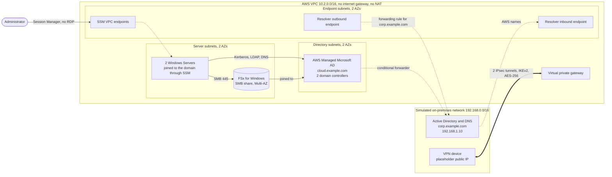

# Hybrid Infrastructure: Managed AD, Site-to-Site VPN and Hybrid DNS on AWS

[](https://github.com/WillFarid/hybrid-infrastructure/actions/workflows/terraform-ci.yml)

A Terraform build of the classic "extend the on-premises Windows network into AWS" scenario: a private VPC connected to an on-premises network over an encrypted Site-to-Site VPN, with AWS Managed Microsoft AD, domain-joined Windows servers, an FSx SMB file share, and DNS that resolves in both directions.

I spent years as a Microsoft sysadmin. This project is the cloud version of work I know from the other side: Active Directory, DNS, file shares and the network that ties them together.

> **Status: validated and planned.** pass (**82 resources**) and every pull request is checked by CI. The on-premises side is simulated: the VPN device address is a documentation placeholder, so the tunnels would stay down until a real device is configured.

## Architecture



## What is built

| Layer | What | Notes |
|---|---|---|
| **Network** | Private VPC `10.2.0.0/16`, 6 subnets in 3 tiers across 2 AZs | No internet gateway or NAT. Flow logs on. Default security group locked. |
| **Private access to AWS** | SSM interface endpoints plus an S3 gateway endpoint | Servers are managed with no internet path |
| **Identity** | AWS Managed Microsoft AD (2 domain controllers) | Security events go to CloudWatch |
| **Servers** | 2 Windows Server 2022 instances, one per AZ | Join the domain automatically through an SSM association. No RDP, no key pair, no public IP, IMDSv2, encrypted disks. |
| **Storage** | FSx for Windows File Server, Multi-AZ | Customer-managed KMS key, file access audit log, daily backups. Reachable only from the servers' security group. |
| **Connectivity** | Site-to-Site VPN, 2 tunnels | IKEv2, AES-256, SHA-2 only. Traffic selectors limited to the two private ranges. Route propagation. Tunnel logs. |
| **DNS** | Conditional forwarder on the AD, Route 53 Resolver inbound and outbound endpoints, forwarding rule | Names resolve both ways across the VPN |
| **AD reachability** | 17 security group rules on the domain controllers | The standard Active Directory ports, opened to the on-premises range only |

## Design decisions

| Decision | Why |
|---|---|
| **Fully private network** | This models a company extending its internal network. Nothing has a public IP and nothing can reach the internet. |
| **Non-overlapping address ranges, enforced in code** | Overlapping ranges cannot be routed over a VPN. A Terraform validation rejects a VPC range that overlaps the on-premises range, and I tested it against exact, contained and containing overlaps. |
| **SSM instead of RDP or key pairs** | There is no inbound admin port to attack. Access is through Session Manager over VPC endpoints. |
| **Security groups reference groups, not IP ranges** | The file share accepts SMB from the servers' group only, so access follows the group, not an address list. |
| **The one secret is handled explicitly** | Managed AD cannot generate its own admin password. It is a `sensitive` variable supplied from the environment, validated against AWS's rules at plan time, and ignored after creation. It is never in a file. |
| **No pre-shared VPN keys in code** | AWS generates a random key per tunnel. |
| **Explicit ordering** | The servers wait for the directory's DHCP options, otherwise they boot with the wrong DNS servers and cannot find the domain. |
| **Static routing** | Works with any device. Production would normally use BGP for faster failover. |
| **Offline-first** | A mock-mode switch on the provider and a local backend in CI let `plan` run with no account. |

## Repository structure

```text
.
├── .github/workflows/terraform-ci.yml   # fmt, validate, tflint, checkov and plan on every pull request
├── modules/
│   ├── network/          # VPC, subnets, route table, endpoints, flow logs
│   ├── directory/        # Managed AD, DHCP options, security logs, AD port rules
│   ├── windows-servers/  # IAM role, instances, SSM domain-join automation
│   ├── file-share/       # FSx for Windows, KMS key, audit logs
│   ├── vpn/              # virtual private gateway, customer gateway, VPN connection
│   └── hybrid-dns/       # resolver endpoints, forwarding rule, conditional forwarder
├── environments/lab/     # root module that wires everything together
└── docs/migration-runbook.md
```

Each module has its own generated README (inputs, outputs, resources) produced by `terraform-docs`.

## Quality gates

Every commit runs through [pre-commit](https://pre-commit.com), and every pull request runs the same checks in GitHub Actions behind a single required status check:

| Tool | Purpose |
|---|---|
| `terraform fmt` and `terraform validate` | Formatting and syntax |
| `tflint` | AWS-aware linting |
| `checkov` | Security scanning |
| `terraform plan` (offline) | Proves the configuration builds, and posts the summary on the pull request |
| `terraform-docs` | Auto-generated module documentation |

## Running it offline

```bash
cd environments/lab

# Local-only override that swaps the S3 backend for a local one (gitignored)
cat > backend_override.tf <<'EOT'
terraform {
  backend "local" {
    path = "terraform.tfstate"
  }
}
EOT

# A placeholder so the plan can run. Never use a real password this way.
export TF_VAR_directory_admin_password='Mock-Passw0rd-123'

terraform init -reconfigure
terraform validate
terraform plan
```

## Migration runbook

[`docs/migration-runbook.md`](docs/migration-runbook.md) covers the human side: DNS, forest trust, file data migration with NTFS permissions, cutover and rollback.

## Honest limitations

- **Simulated on-premises side.** The VPN device IP is a documentation address, and the tunnels would stay down until a real device holds the configuration.
- **No trust is created.** A forest trust between `corp.example.com` and `cloud.example.com` needs an administrator on both sides, so it is in the runbook instead.
- **No automated deployment.** This repository has CI only. The approval-gated apply pattern, with OIDC credentials and protected environments, is in [Terraform CI/CD with Security and Policy Gates](https://github.com/WillFarid/terraform-CI-CD-with-security-and-policy-gates).
- **Cost.** A real deployment bills hourly and would run to several hundred dollars a month. The largest items are the Route 53 Resolver endpoints (billed per network interface), Managed AD, FSx, the VPN and the interface endpoints. Do not apply it casually.

## What I would add next

- A Transit Gateway instead of the virtual private gateway once there is more than one VPC.
- BGP routing and a second customer gateway for device redundancy, or Direct Connect with the VPN as backup.
- DNS query logging on the resolver, and a customer-managed key for the CloudWatch log groups.
- A scheduled drift-detection plan, and Infracost cost estimates on pull requests.

## Skills demonstrated

AWS networking (VPC design, VPN, route propagation, Route 53 Resolver, VPC endpoints), Active Directory and DNS in a hybrid design, Windows Server automation through SSM, FSx for Windows, least-privilege security groups and IAM, KMS, Terraform modules, validation and ordering, and CI with GitHub Actions.

## 👩‍💻 Author

**Will Farid**, Cloud Engineer

## ⭐ Support

If you found this project useful, consider giving it a ⭐ on GitHub.
